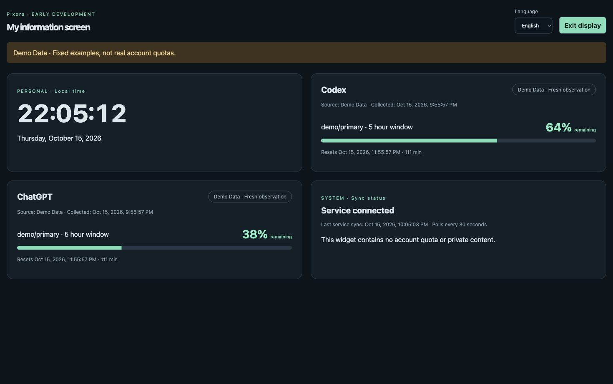

# Pixora

> V0.3 development build: public GitHub activity, RSS/Atom, local JSON tasks, scoped access and private widgets. See [V0.3 scope and acceptance](docs/V0.3.md). Calendar, weather, task editing and a stable Release remain planned.

[](https://github.com/kongjiestak/pixora/actions/workflows/test.yml)

**Make Every Screen Useful.**
[English](README.md) | [简体中文](README.zh-CN.md)

**Early Development — not an accepted V0.1 release.** Pixora is a working brand, not a cleared trademark. This repository continues AI Pocket Monitor (APM); its commits and historical release are retained. No new Pixora Release is claimed.

An open-source, self-hostable platform that turns everyday screens into personalized information hubs. Software comes first: no dedicated hardware, purchased VPS, or mandatory cloud service is required. Live Codex data depends on your own Codex sign-in and its upstream service.

**One Platform. Any Screen. Your Way.**
**Your Screen. Your Data. Your Control.**

Actual running build, **Demo Data only** (not account quotas):



## What runs today

| Capability | Actual status |
|---|---|
| FastAPI + SQLite, Mac outbound collector | Implemented; local HTTP roundtrip tested |
| Codex quota via local app-server | Implemented; real reads tested; CLI/account/network compatibility may change |
| ChatGPT personal subscription quota | Unavailable; no stable public personal-quota API is integrated; never estimated |
| English / Simplified Chinese | Vue I18n, detection, switch, fallback, preference storage, Intl formatting |
| Clock / quota / sync widgets | Implemented, registry, presets, dark/light themes |
| Browser device settings | Local only; name, theme, layout, sharing; no server device-management UI |
| Responsive display / Kiosk | Implemented; browser viewport checks; full-screen and wake lock are best effort |
| PWA | Manifest, icons and offline public shell; iPhone Home Screen installation accepted by owner; Android 13 portrait/landscape display accepted, installation not yet tested |
| Remembered device login | HTTPS HttpOnly cookie, expiry, logout and live device revocation; [session guide](docs/device-sessions.md) |
| Shared display privacy | Local filter plus opt-in server provider/mode scoped tokens; [device guide](docs/DEVICES.md) |
| Docker Compose | Provided; current validation is recorded in [verification](docs/VERIFICATION.md) |
| Linux system monitoring | Real host CPU/memory/root-disk, private widget and bounded history; [V0.2](docs/V0.2.md) |
| Developer / personal integrations / controls / ESP32 | Roadmap, except local clock; no hardware firmware or simulator in this revision |

## Run on your Mac or Linux computer

Python 3.11+ and Node.js 22+. From the repository root:

```sh
python3 -m venv .venv
source .venv/bin/activate
pip install -r requirements-lock.txt
pip install --no-deps .
python scripts/setup_env.py
set -a
source .env
set +a
npm --prefix web ci
npm --prefix web run build
uvicorn pixora.server:create_app --factory --host 127.0.0.1 --port 8000
```

Open [localhost](http://127.0.0.1:8000). Enter `PIXORA_READ_TOKEN` from your local `.env`. For this legacy-token localhost example, uncheck **Remember this device**; the token stays in page memory. Scoped device tokens can instead establish a persistent HTTPS session (see [device sessions](docs/device-sessions.md)). Open another terminal in the same directory:

```sh
source .venv/bin/activate
set -a
source .env
set +a
# No external account needed; select Demo data in the dashboard.
pixora-collect --plugin demo --once
# Real Codex: install and sign in to Codex CLI on this Mac first.
pixora-collect --plugin codex --once
# Poll continuously (default 120 seconds, delivery failures back off).
pixora-collect --plugin codex
```

Use `PIXORA_CODEX_BIN` for a non-PATH CLI. `--print-only` queries locally without upload: its output contains account observations, so do not publish it. Empty/error/stale data is explicit. Demo never replaces real observations automatically.

## Self-host with Docker / PVE

```sh
python3 scripts/setup_env.py
docker compose config --quiet
docker compose up -d --build
```

Docker Engine with Compose must be running. Default bind is host loopback. Data is in `pixora-data`; do not use `down -v` unless you intend to erase it. PVE deployment should use a Linux VM; the Mac pushes outbound observations. A VPS is optional. See [deployment and migration](docs/DEPLOYMENT.md).

Phones need a deliberately configured LAN/private-network address. Full PWA support requires HTTPS or localhost; ordinary LAN HTTP cannot guarantee installation or offline mode. Android installation and iOS “Add to Home Screen”, old OS behavior, background work and continuous screen wake are **not verified across real devices**. `/?kiosk` starts display mode; controls allow exit. Read tokens must stay within one trusted household/account boundary.

## Data and security

- `POST /api/v1/snapshots`: collector write token only. `GET /api/v1/device?mode=real|demo`: display read token or scoped read-only session. `/healthz` is public.
- Bearer headers for collectors/manual tokens; optional scoped HttpOnly HTTPS sessions for displays, distinct 32+ character tokens, no query tokens; local clock, receipt time, collection time, reset time and stale states are distinguished.
- `collected_at` is returned alongside legacy `observed_at`; ingest accepts either. Structured `reason_code` enables translation. Unknown values never mean zero remaining.
- Credentials remain with Codex on the collector Mac. No cookies, raw RPC, prompts, private account details or personal databases are shipped. API responses are never cached by the service worker.
- Independent display tokens now enforce provider/mode scope, expiry and live revocation on the server. Provision with the local CLI; [device guide](docs/DEVICES.md). The legacy global read token still sees all data until explicitly disabled. Shared-screen UI filtering alone is not access control. No control commands are implemented.
- Pixora is a provisional working name with existing unrelated uses. No trademark ownership or affiliation with OpenAI, GitHub, Espressif or Home Assistant is claimed.

## Development

```sh
python -m pytest -q
npm --prefix web test
npm --prefix web run build
npm --prefix web run dev
```

Dev UI proxies `/api` to port 8000; run the Python service separately. CLI `apm-collect` and `APM_*` environment variables remain migration aliases; `PIXORA_*` wins if both exist. The Python import path is now `pixora`; see migration guidance before reusing an old database or Docker volume.

[Architecture](docs/ARCHITECTURE.md) · [Roadmap](docs/ROADMAP.md) · [I18N](docs/I18N.md) · [Verification](docs/VERIFICATION.md) · [Audit](docs/AUDIT.md) · [Security](docs/SECURITY.md) · [Contributing](CONTRIBUTING.md) · [Brand](docs/BRAND.md)

## License

[MIT](LICENSE), preserving the original APM contributor notice. Third-party dependencies retain their own licenses; see [notices](THIRD_PARTY_NOTICES.md). The Pixora brand is not an exclusive trademark grant.
