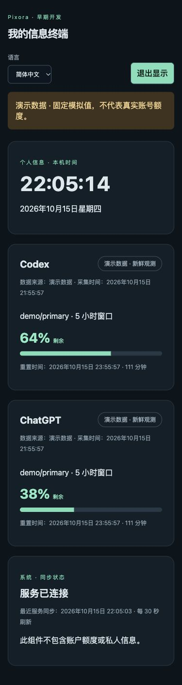

# Pixora

[](https://github.com/kongjiestak/pixora/actions/workflows/test.yml)

**Make Every Screen Useful. / 让每一块屏幕都有价值。**
[English](README.md) | [简体中文](README.zh-CN.md)

**Early Development（早期开发），尚未完成 V0.1 全部验收。** Pixora 当前是未经商标审查的工作品牌。本项目延续 AI Pocket Monitor（APM），保留原提交与历史 Release，本轮不宣称新 Pixora 正式版完成。

一个开源、可自托管、支持多语言与多设备的个人信息展示及交互平台。软件优先，让闲置手机、平板和电脑成为信息终端；未来再适配 ESP32。不需要购买专用硬件或 VPS，不强制使用云服务。Codex 真实数据仍依赖用户自己的登录和上游服务。

**One Platform. Any Screen. Your Way.**
**Your Screen. Your Data. Your Control.**

下图来自实际运行页面，**仅为明确标识的演示数据，不是账号额度**：



## 实际功能

| 功能 | 当前状态 |
|---|---|
| FastAPI + SQLite、Mac 出站采集 | 已实现，本机 HTTP 闭环已测试 |
| Codex 真实额度 | 本机 app-server 查询已实现并实测；兼容性受 CLI、账号、网络影响 |
| ChatGPT 个人订阅额度 | 未接入稳定公开额度 API，始终不可用，不推算、不伪造 |
| 英语 / 简体中文 | Vue I18n，检测、切换、回退、偏好存储，Intl 格式化 |
| 时钟 / 额度 / 同步 Widget | 已实现，注册表、布局预设、明暗主题 |
| 设备配置 | 仅当前浏览器本地保存名称、主题、布局、共享选项，无服务端设备管理界面 |
| 响应式 / Kiosk | 已实现，浏览器尺寸检查；全屏和常亮按平台能力尽力调用 |
| PWA | manifest、图标与离线公共壳已实现，手机真机安装尚未验收 |
| 共享隐私 | 本机过滤 + 可选服务端逐设备数据源/模式权限，见[设备指南](docs/DEVICES.md) |
| Docker Compose | 配置已提供，实测范围见[验证报告](docs/VERIFICATION.md) |
| 系统 / 开发者 / 完整个人信息 / 控制 / ESP32 | 除本机时钟、同步状态外均为后续规划，本轮无硬件固件或模拟器 |

## 本机运行

需要 Python 3.11+、Node.js 22+。在仓库根目录：

```sh
python3 -m venv .venv
source .venv/bin/activate
pip install -r requirements-lock.txt
pip install --no-deps .
python scripts/setup_env.py
set -a
source .env
set +a
npm --prefix web ci
npm --prefix web run build
uvicorn pixora.server:create_app --factory --host 127.0.0.1 --port 8000
```

打开[本机页面](http://127.0.0.1:8000)，填写本机 `.env` 的 `PIXORA_READ_TOKEN`，令牌仅存页面内存。第二终端同目录：

```sh
source .venv/bin/activate
set -a
source .env
set +a
# 无需外部账号；在网页选择“演示数据”
pixora-collect --plugin demo --once
# 真实额度：先在 Mac 安装并登录 Codex CLI
pixora-collect --plugin codex --once
# 持续采集，默认 120 秒，推送失败退避
pixora-collect --plugin codex
```

找不到 CLI 时设置 `PIXORA_CODEX_BIN`。`--print-only` 仅本机查询、不上传，但会输出账号观测，勿公开。缺失、失败、过期会明确显示，真实数据不会自动回退为演示。

## Docker / PVE 自托管

```sh
python3 scripts/setup_env.py
docker compose config --quiet
docker compose up -d --build
```

需先运行 Docker Engine 与 Compose。默认绑定宿主回环地址；数据在 `pixora-data` 卷，`down -v` 会删除它。PVE 建议使用 Linux VM，Mac 主动推送数据，VPS 可选。详见[部署与旧版迁移](docs/DEPLOYMENT.md)。

手机访问需要显式配置局域网或私网入口。PWA 完整能力需要 HTTPS 或 localhost；普通局域网 HTTP 不保证安装与离线。Android 安装、iOS 添加主屏幕、旧系统后台和长期常亮**尚未逐机型验收**。`/?kiosk` 可直接进入显示模式，也可退出。

## 数据与安全

- 写端点 `POST /api/v1/snapshots` 只接受采集令牌；读端点 `GET /api/v1/device?mode=real|demo` 只接受只读令牌；`/healthz` 公开。
- 两个不同的 32 字符以上随机令牌通过 Bearer 头传递，不放 URL。显示采集、接收、重置时间与过期状态，不把未知值显示为零。
- `collected_at` 与旧版 `observed_at` 并存；写入可使用任一字段；`reason_code` 提供可翻译状态。
- Codex 凭据留在 Mac，本项目不传输 Cookie、原始 RPC、提示词或私人账号资料。服务工作线程不缓存 API。
- 已支持服务端逐设备令牌、数据源/真实演示范围、期限与即时撤销，见[设备指南](docs/DEVICES.md)。旧全局只读令牌默认仍可读取全部额度，迁移后须显式禁用。共享模式本身仍是本机过滤。没有控制命令。
- Pixora 已有第三方使用，未宣称商标独占，也未宣称与 OpenAI、GitHub、Espressif、Home Assistant 有关联。

## 开发

```sh
python -m pytest -q
npm --prefix web test
npm --prefix web run build
npm --prefix web run dev
```

开发页面把 `/api` 代理到 8000，需另启 Python 服务。旧 `apm-collect` 和 `APM_*` 环境变量保留迁移兼容，`PIXORA_*` 优先；Python 导入路径改为 `pixora`。旧数据库与 Docker 卷迁移须先备份。

[架构](docs/ARCHITECTURE.zh-CN.md) · [路线图](docs/ROADMAP.zh-CN.md) · [国际化](docs/I18N.md) · [验证](docs/VERIFICATION.md) · [审计](docs/AUDIT.md) · [安全](docs/SECURITY.md) · [贡献](CONTRIBUTING.md) · [品牌](docs/BRAND.md)

## 许可证

[MIT](LICENSE)，保留原 APM 贡献者署名。第三方依赖遵循各自许可证，见[第三方声明](THIRD_PARTY_NOTICES.md)。开源代码许可不代表 Pixora 品牌独占授权。
