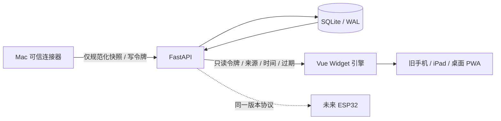

# APM 总体架构 · 2026-10-15

APM 是自托管、硬件无关的个人信息与监控平台。Web/PWA 是第一类显示终端，未来 ESP32 使用同一只读设备接口。五大模式是模块分类，可混合布局，不是五套独立应用。

## V0.1 实现
- Python 3.11+ FastAPI，SQLite 保存每个 provider/mode 最新快照；不含历史曲线。
- Mac 出站采集：allowlist Collector 协议 + Codex / Demo 实现；本机 Codex app-server 登录由 Codex 管理。APM 不读取或传输其凭据。
- 只读 Bearer 与采集 Bearer 分开，启动时强制不同且至少 32 字符，限制写入体积、时间倒流、未来时间、错误假额度。
- Vue 3 Widget registry 声明 mode/sensitivity，预设数组组合时钟、额度、同步状态组件。设备名称/主题/布局/共享选项存 localStorage，令牌与账户数据仅内存。重启需重新连接。
- 浏览器时钟按秒更新、额度按 30 秒拉取；服务端和客户端分别处理观测过期、断线缓存、窗口重置。数据源始终标识，demo 不自动替代 real。
- PWA manifest、图标、公共壳缓存；API 永不缓存。HTTPS 或 localhost 才支持 Service Worker；普通局域网 HTTP 不具备完整安装能力。

## 扩展接口
Collector.collect() -> list[Snapshot]；V0.1 quota schema 显式限制 codex/chatgpt，禁止随便把未知数据当额度。未来新增通用 Observation v2：{connector_id, mode, metric, value, unit, observed_at, expires_at, sensitivity, provenance}，独立 schema migration，保留 v1 读兼容。
Widget registry 当前字段 {title, mode, sensitivity}，kind 与 Vue 组件对应，输入 {data, clock, connected}；新增 Widget 必须声明可公开字段、空值/过期/演示状态和低性能终端降级。

| 模式 | 未来连接器 | Widget 扩展 |
|---|---|---|
| AI | 有可靠来源的 Codex/其他平台 | 额度、费用、重置 |
| 系统 | PVE/NAS/主机 agent | 资源、温度、离线 |
| 开发者 | GitHub/GitLab/CI | PR、构建、部署 |
| 个人信息 | CalDAV、天气、待办、邮件摘要、预算、习惯、RSS | 日程、提醒、通勤、目标 |
| 自动化控制 | Home Assistant、规则执行器 | 控制按钮、确认、执行审计 |

控制必须走未来独立 command API、权限与审计，禁止扩展只读设备令牌为写控制凭据。首版没有执行控制能力。

## 隐私与部署
首版单用户单信任域，所有只读令牌持有者都能读 AI 额度；共享开关是本机显示保护，不是服务器多用户 ACL。不要向不可信公共终端发放该令牌。后续实现每设备权限、字段裁剪、撤销与屏幕锁。
Mac 可独立运行，无需 VPS。PVE Linux VM/LXC Docker 常驻可避免 Mac 休眠导致服务离线；Mac 休眠时真实快照过期。日本 VPS 可选，启用 TLS 与防火墙后再接入。SQLite 持久卷需备份；不存浏览器 Cookie、完整邮件或个人财务原文。

硬件固件、多尺寸 ESP32、NFC、MagSafe、自研 PCB 均不属于 V0.1。
