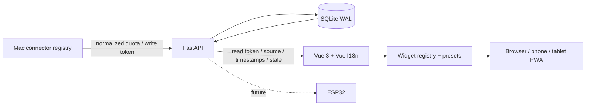

# Pixora architecture

[English](ARCHITECTURE.md) | [简体中文](ARCHITECTURE.zh-CN.md)

Software-first monorepo. Browser/PWA is a first-class display; a future ESP32 reads the same versioned device API. Five modes are extensibility categories, not five completed applications.

## Implemented contracts

- `Collector.collect() -> list[Snapshot]`: allowlisted Codex and demo collectors. No arbitrary remote plugin loading.
- Snapshot v1: `provider`, `source`, `mode`, `status`, `observed_at` (ingest alias `collected_at`), `windows`, optional `reason_code`. API returns both timestamp names plus receipt time, age and stale. Quota schema intentionally limits providers; it is not a universal metrics schema.
- Widget registry: `{titleKey, mode, sensitivity}`. Vue widget inputs `{data, clock, connected}`; display logic uses locale keys and raw structured fields. UTC storage, local-zone Intl presentation. `public` widgets can display without quota credentials; sharing clears token and pending requests.
- SQLite retains the latest provider/mode only, no history. Transactions reject older replayed observations; connections close after each operation. Single trust domain and separate read/write token capabilities.
- Three layouts, light/dark themes and device configuration are browser-local. No server-managed device registry or drag/drop editor.
- PWA precaches public shell and built assets. No API/token/observation persistence. Reload needs a token. HTTPS/localhost required. Screen wake and full-screen are browser-dependent.

## Future contracts and boundaries

Observation v2 will separate connector ID, mode, metric, value, unit, collection/expiry timestamps, provenance and sensitivity, with SQLite migration and v1 read compatibility. Connector SDK/configuration is still planned.

AI / system / developer / personal / automation widgets may share one layout. PVE/NAS, CI, calendar/tasks/weather, private summaries and Home Assistant connectors are planned. Commands require a separate authorized, audited, idempotent channel; read tokens will never implicitly gain write/control capabilities.

Per-device token revocation, field-level ACL and public-screen data projection must be implemented on the server before untrusted public deployments. Local UI filtering is not this protection.

Run on a Mac alone, or keep the service in a PVE Linux VM while the Mac pushes outbound observations. Mac sleep makes data stale. A VPS is optional. ESP32 sizes, NFC, MagSafe and PCB work are future hardware exploration, not current compatibility claims.
